---

authors:
  - sorkin
  - makarov
icon: material/printer-3d
title: 3D рекомендатор - принтеры
subtitle: Лучшие модели под разные задачи
description: Какой принтер купить, а какой не стоит?
---

# 3D рекомендатор: Принтеры

!!! note "Рекомендуются только те принтеры, которые я лично тестировал, или близкие к ним - увеличенные/уменьшенные версии, другие комплектации и т.д. Если какого-то принтера в списке рекомендованных нет, это не всегда значит, что он плохой. Это может значить, что я его еще не успел протестировать"

!!! tip "Если у вас остались вопросы, то присоединяйтесь к [:simple-telegram: крупнейшему русскоязычному чату по 3D печати K3D](https://t.me/K_3_D){ target="_blank" }"

## Базовая печать { #basic }

### Bambu Lab A1 mini

_Малогабаритный базовый принтер_{ .printer-role }

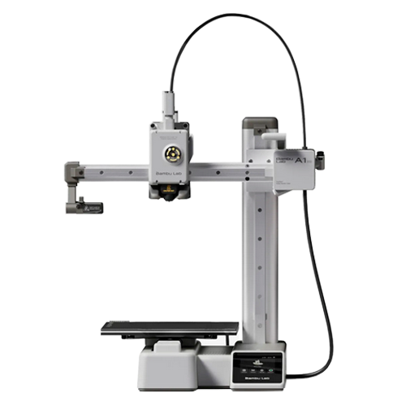{ width="260" }

|                  |                                                                                               |
|:-----------------|:----------------------------------------------------------------------------------------------|
| Стоимость        | 16000-20000р                                                                       |
| Область печати   | 180х180 мм                                                                                    |
| Обзор            | [:simple-youtube: YouTube](https://youtu.be/jPOvMQSrHZQ){ target="_blank" }                    |
| Купить           | [:material-shopping: AliExpress](https://alli.pub/7a29bi?erid=2SDnjd7F7Pc){ target="_blank" }  |

A1 mini плохо подходит под задачи технической печати т. к. из-за стола, греющегося всего до 80°C, он будет ограничен по номенклатуре поддерживаемых материалов. Плюс из-за открытого корпуса прочность деталей из АБС и подобных материалов будет снижена. Эластомерами принтер стабильно печатает только средне-мягкими, которых хватит для большинства задач. Но самые мягкие принтеру, можно сказать, недоступны.

Но, зато, этот принтер очень качественный, особенно учитывая его низкую цену. Он небольшой и может работать почти бесшумно. А также он самостоятельно калибрует большее количество параметров, нежели конкуренты. Благодаря этому решать базовые задачи печати из PLA, PETG, SBS, TPU и подобных материалов на нём легко и комфортно.

Также к принтеру можно подключать мультиматериальные системы Bambu Lab, и есть комплекты сразу с AMS Lite. Подобная система, хоть супер-медлительная и супер-расточительная, но позволяет печатать многоцветные детали. А также может быть проапгрейжена для долговременного хранения филамента.

### Bambu Lab A1

_Среднегабаритный базовый принтер_{ .printer-role }

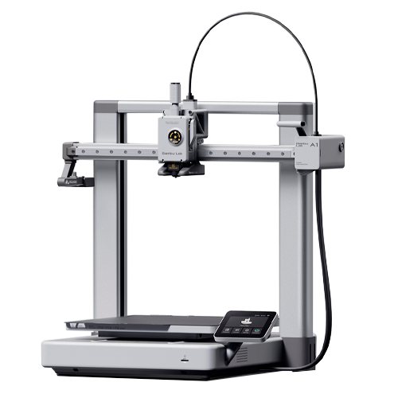{ width="260" }

|                  |                                                                                               |
|:-----------------|:----------------------------------------------------------------------------------------------|
| Стоимость        | 27000-30000р                                                                       |
| Область печати   | 256x256 мм                                                                                    |
| Обзор            | [:simple-youtube: YouTube](https://youtu.be/jPOvMQSrHZQ){ target="_blank" }                    |
| Купить           | [:material-shopping: AliExpress](https://ali.click/p7leoy?erid=2SDnjcpg34j){ target="_blank" } |

Bambu Lab A1 - увеличенная версия A1 mini. Обладает теми же плюсами: качественный, относительно недорогой, может быть очень тихим, автоматически калибрует почти все параметры и т.д. Но при этом стол у этой модели увеличен до 256х256 мм. А также стол греется до 100°C, из-за чего проще печатать нетребовательные к прочности детали из ABS, ASA и подобных материалов.

## Инженерная печать { #engineering }

### Bambu Lab X2D

_Рекомендуемая модель под инженерную печать_{ .printer-role }

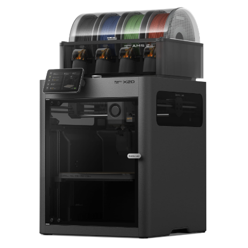{ width="260" }

|                  |                                                                                               |
|:-----------------|:----------------------------------------------------------------------------------------------|
| Стоимость        | ~70000-90000₽ |
| Область печати   | 256x256 мм |
| Обзор            | [:simple-youtube: YouTube](https://youtu.be/xmrUdBrgTOY){ target="_blank" } |
| Купить           | [:material-shopping: AliExpress](https://ali.click/c8l8o18?erid=2SDnjcPdGJx){ target="_blank" }  |

Bambu Lab X2D - один из самых сбалансированных принтеров, ориентированных на инженерную печать. Механика у него относительно медленная, зато относительно мало рябит, и, самое главное, она очень надёжная и беспроблемная. На практике принтеры с этой механикой могут отходить много тысяч часов без значимых поломок.

На голове "полуторный" экструдер, который отлично справляется с самыми распространёнными задачами инженерной печати - легкоотделяемыми поддержками, надписями и логотипами. Хотэнды греются до 310°С, стол до 120°С, плюс есть термокамера на 65°С, благодаря чему можно печатать прочные детали из любых инженерных материалов, кроме PPS. При этом хотэнды и обдув имеют очень высокую производительность, а также принтер напичкан удобствами: фильтрацией воздуха, вентиляцией отсека печати, автокалибровкой PA на основном экструдере, удобной AMS 2 Pro и т.д.

Из минусов можно отметить разве что закрытый софт и относительно высокую цену. Но, справедливости ради, современный бамбуковский софт душит уже не так сильно, как раньше. А по цене - принтеров с такими же возможностями и надёжностью дешевле нет.

Суммарно получается принтер, который отлично справляется с техничкой, но при этом и с художкой проблем никаких, и многоцвет иногда можно, и мозги особо не делает в ходе эксплуатации. Отличный выбор для тех, кому хватает бюджета на его покупку.

??? compare "Сравнить с QIDI Q2"

    _Q2 стоит почти вдвое дешевле, имеет область печати чуть больше, ускорения повыше, а также хотэнды греются лучше, за счёт чего становится доступен PPS. Но при этом у него менее производительные хотэнды, сильно менее производительный обдув, нет двойного экструдера и уровень качества и надёжности заметно хуже. Поэтому, если есть деньги на X2D, то я бы брал его. Если же бюджет не позволяет взять X2D, а техничку печатать надо, тогда Q2 будет оптимальным выбором_

??? compare "Сравнить с Snapmaker U1"

    _Принтеры крайне разные. X2D имеет активную термокамеру. Хотэнды и обдув заметно более производительные. А мультиматериальная система, хоть и способна распечатать трёх-четырёхцветную деталь, но больше заточена под печать легкоотделяемых поддержек, надписей, логотипов и тому подобного, что часто встречается в техничке. Snapmaker U1 имеет заметно менее производительные хотэнды и обдув, не имеет даже пассивной термокамеры, не имеет сушилки и системы хранения филамента. Зато имеет 4 полноценные печатающие головы, которые будут экономить много времени при печати трёх-четырёхцветных деталей. А также имеет неплохую электронику с открытой прошивкой, за счёт чего хорошо поддаётся доработкам. Итого получается, что если у вас большая часть задач - инженерная печать, а мультиматериал нужен редко, то берите X2D. Если у вас сплошные многоцветные детали, а продвинутой инженерной печати не бывает, тогда U1_

??? compare "Сравнить с Bambu Lab P2S"

    _P2S отличается от X2D заметно более высоким уровнем ряби, наличием только 1 экструдера, а также отсутствием нагревателя термокамеры. При этом цена ниже на ~20000р. На первый взгляд может показаться, что адеквватный вариант - по возможностям урезали, но и денег просят меньше. Но есть одно большое но: возможностей отрезали столько, что P2S стал функциональным аналогом A1. Он буквально не может решать какие-то задачи, которые A1 решать не мог бы, или решал бы плохо. При этом A1 дешевле на ~20000р., меньше рябит и заметно более тихий. Поэтому P2S покупать смысла нет. Либо берите A1, либо X2D_

??? compare "Сравнить с Bambu Lab H2D"

    _H2D имеет область печати заметно больше, хотэнды такие же, но греть их можно уже до 350°С, а также оба экструдера полноценные. Несмотря на то, что по цифрам всё хорошо, но на практике увеличенная максимальная температура хотэнда даёт только возможность печати PPS, который очень мало кому нужен. А то, что второй экструдер полноценный, в рамках технической печати вообще почти ничего не меняет. Поэтому я бы рассматривал H2D как просто заметно увеличенную версию X2D (или, наоборот, X2D как заметно уменьшенную версию H2D)._

### QIDI Q2

_Более дешёвая альтернатива под техничку_{ .printer-role }

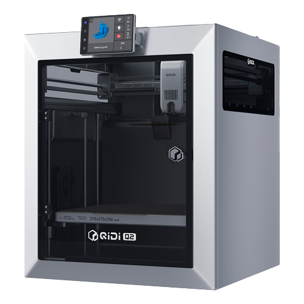{ width="260" }

|                  |                                                                                               |
|:-----------------|:----------------------------------------------------------------------------------------------|
| Стоимость        | ~40000-50000₽                                                                                |
| Область печати   | 270x270 мм                                                                                    |
| Обзор            | [:simple-youtube: YouTube](https://youtu.be/V9vqKQp8-GM){ target="_blank" }                    |
| Доработки        | [:material-file-document: Подробнее + про исправление косяков](../printers/qidi_q2/index.md){ .target=_blank } |
| Купить           | [:material-shopping: AliExpress](https://alli.pub/7a29ef?erid=2SDnjcyqWTp){ target="_blank" }  |

QIDI Q2 - принтер во многом сырой и требующий донастройки. Но все проблемы устраняются софтверно, да и занимает это немного времени по уже существующей [готовой инструкции](../printers/qidi_q2/index.md){ .target="_blank" }.

Зато после донастройки Q2 является одним из лучших принтеров по соотношению возможности/цена. У него высокие лимиты температур (стол 125°C, хотэнд 350°C), активная термокамера до 65°C, довольно неплохая область печати, относительно высокие ускорения, очень низкий уровень ряби и экструдер, способный отлично печатать даже очень мягкими эластомерами.За такие деньги ничего, что хотя бы приближалось бы к нему по возможностям, нет.

 является одним из самых универсальных принтеров этого. В технической печати помогут высокие максимальные температуры (стол 125°C, хотэнд 350°C) и активная термокамера до 65°C. Благодаря этому принтер может печатать всеми распространёнными инженерными материалами и с высокой прочностью. Эластомерами принтер тоже печатает очень хорошо, стабильно выдавая хорошие результаты даже на самых мягких типа ТПУ А75.

В художественной печати немного помешает не очень производительное охлаждение. Но это только ограничивает максимальную скорость. Со стабильностью всё хорошо даже на самых легкоплавких материалах.

## Под доработку

### FlashForge AD5M

_Дешёвый принтер под доработку_{ .printer-role }

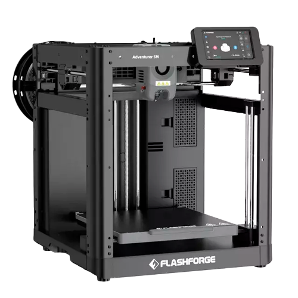{ width="260" }

|                  |                                                                                               |
|:-----------------|:----------------------------------------------------------------------------------------------|
| Стоимость        | ~17000р                                                                                |
| Область печати   | 220x220 мм                                                                                    |
| Обзор            | [:simple-youtube: YouTube](https://youtu.be/Cgj59XTgrjE){ target="_blank" }                    |
| Купить           | [:material-shopping: AliExpress](https://ali.click/7y4fo7?erid=2SDnjeHL4eb){ target="_blank" } |

Adventurer 5M - компактный, относительно быстрый (~7500 мм/с²) и рябит не сильно. Электроника очень чахлая, может вылететь в ошибку от неправильного выставления параметров или совершения некоторых действий с принтером пока тот печатает.

Хотэнд, с одной стороны, производительнее среднего. С другой стороны, из-за неудачного крепления не может греться выше 280°C. Следовательно, в стоке принтер не способен решать никакие задачи, кроме базовой печати. Но в них он на голову хуже Bambu Lab A-серии т. к. скорость печати не настолько больше, чтобы компенсировать куда худшее качество, шумность, нестабильность, отсутствие автокалибровки ПА и т.д.

Иными словами, этот принтер имеет смысл только тогда, когда нужна продвинутая техническая печать, или печать мягкими эластомерами, но денег на принтер, который это всё хорошо смог бы в стоке, нет. Купить Adventurer 5M за ~18000р, а потом по чуть-чуть доработать его еще на ~10000р финансово проще, чем единоразово вложить в готовый принтер 35000-50000р.

### Sovol SV08

_Дешёвый крупногабаритный принтер_{ .printer-role }

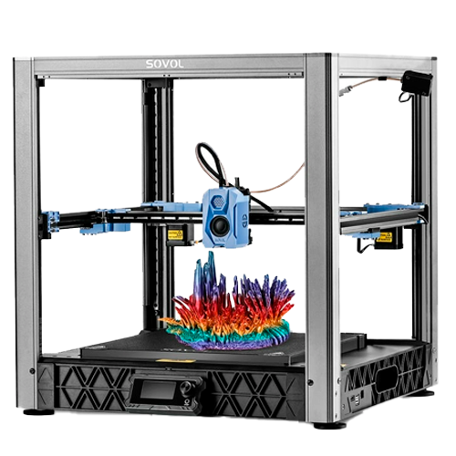{ width="260" }

|                  |                                                                                               |
|:-----------------|:----------------------------------------------------------------------------------------------|
| Стоимость        | ~38000р (250$)                                                                                |
| Область печати   | 350x350 мм                                                                                    |
| Обзор            | [:material-file-document: Обзор на сайте](../articles/sv08/sv08.md){ .target=_blank }          |
| Купить           | [:material-shopping: AliExpress](https://ali.click/mu9foz?erid=2SDnje5VWKZ){ target="_blank" } |

Sovol SV08 довольно быстрый для своей области печати (~7000 мм/с²). Диапазоны скоростей без ряби не очень большие, но есть. Хотэнд по производительности средний, но обдув заметно производительнее среднего. Электроника, хоть и дешёвая, но и без каких-то дурацких решений. Прошивка - почти чистый Klipper, легко меняется на полностью стоковый Klipper. А также производителем выложены сборки механики, что сильно упрощает апгрейды принтера.

В противовес этому обдув очень шумный. Хотэнда для такой области печати как будто бы маловато. Датчик автоуровня страдает от температурного дрейфа. А также есть проблема с неправильным креплением стола, из-за чего тот сильно выгибается при нагреве. Решается она [переделкой крепления на пружины или силиконовые прокладки](https://youtu.be/xGcPHl1sPP0?si=yl4EX0q_MFG_qae8){ target="_blank" }.

В общем, хотите, чтобы что-то подобного габарита не надо было дорабатывать, увеличивайте бюджет раз в 5. Sovol SV08 - это дешёвый крупногабаритный принтер, который в стоке не идеален, но печатает. Но хорошо апгрейдится, благодаря чему можно его легко доделать до выполнения продвинутых задач, скоростной печати и т.д.

Также надо отметить, что у SV08 есть увеличенная версия - [SV08 Max](https://ali.click/9jefoq?erid=2SDnjeh6tVV){ target="_blank" }. Она имеет стол 500x500 мм, но ускорения ниже (~4000 мм/с²) и цена сильно выше.

## Нерекомендуемые принтеры

В данном разделе содержится информация о том, почему некоторые протестированные мной принтеры не попали в список рекомендуемых, или выбыли из него. Обратите внимание, что факт нахождения в этом списке не значит, что принтер ужасен, печатать не может и т.д. Просто персонально я считаю, что именно покупать принтеры из этого списка на данный момент смысла не имеет по тем или иным причинам. Если какой-то из этих принтеров у вас есть, и он вас устраивает, то менять его не надо.

- 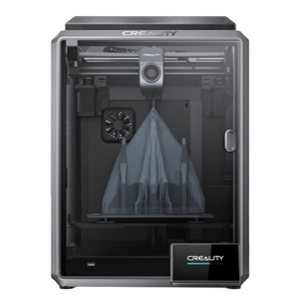{ width="120" }

    **[Серия Creality K1](https://alli.pub/7afa8z?erid=2SDnjeRBq1R){ target="_blank" }**

    ---

    Несмотря на некоторую проблемность, эти принтеры славились как хорошие заготовки под апгрейд. Но Creality на K1C выпустили обновлённую электронику, у которой прошивка закрыта. Это делает апгрейды и донастройку принтера невозможной. Опасность получить такую "улучшенную" электронику есть и на других принтерах серии.

- 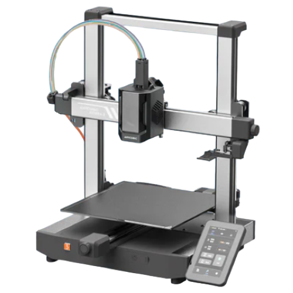{ width="120" }

    **[Anycubic Kobra 3](https://alli.pub/7afa9r?erid=2SDnjexKZvf){ target="_blank" }**

    ---

    Довольно большое количество случаев окирпичивания электроники при попытках установить кастомные прошивки. А на стоковой прошивке принтер не может соперничать с Bambu Lab A1.

- 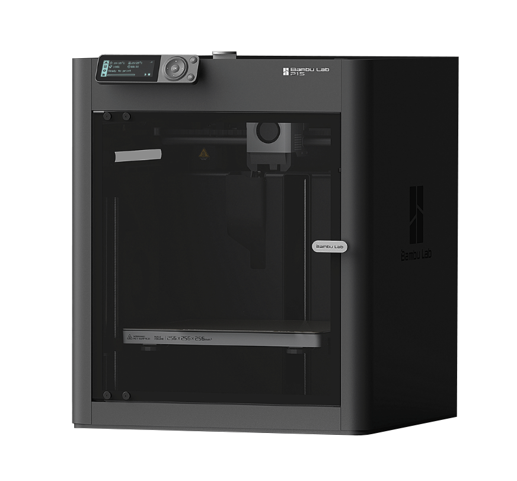{ width="120" }

    **[Bambu Lab P1S](https://ali.click/874qz3?erid=2SDnjdPUoBw){ target="_blank" }**

    ---

    Эта модель не выдерживает конкуренции с A1 т. к. при том же размере области печати и ограничениях по температурам, нет автокалибровки PA, работает P1S заметно громче, сильно рябит и стоит значительно дороже. Единственное, что P1S может предложить поверх A1 - закрытый корпус, который на прочность деталей почти не влияет, но защищает механику от пыли. КМК, это не компенсирует плюсы А1.

- 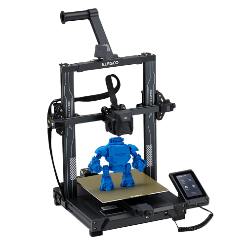{ width="120" }

    **[Серия Neptune 4](https://alli.pub/7afabp?erid=2SDnjcCDEyM){ target="_blank" }**

    ---

    Нет акселерометров и Wi-Fi, которые придётся докупать, устанавливать и настраивать самостоятельно. Бывает, что механику нельзя настроить без слесарной доработки деталей. Характеристики по современным меркам уже слабоваты

- 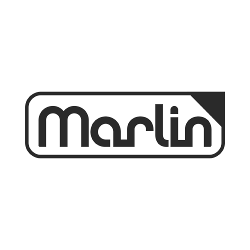{ width="120" }

    **Принтеры на прошивке Marlin**

    ---

    Хоть принтеры на этой прошивке до сих пор могут печатать с хорошим качеством, но отсутствие нормальной реализации Input Shaping'а делает их медленными. Плюс к этому, новых принтеров на этой прошивке не делают, следовательно, всё, что есть в продаже - принтеры, вышедшие несколько лет назад. Естественно, за столько времени большинство из них уже устарело.

---

^`Реклама: ООО "АЛИБАБА.КОМ (РУ)" ИНН 7703380158`^[^1]
^`Реклама. ООО "АЕР Услуги" ИНН 7703380158.`^[^1]

[^1]: Нет человека или юр.лица, которые заказали бы создание этой страницы или рекламу товаров, приводимых на этой странице. Я создал все статьи в рекомендаторе сам, по своему желанию и в целях сообщества. Тем не менее, по законодательству РФ, любая ссылка на товар является рекламой. Поэтому я вынужден делать эту приписку, чтобы не нарушать закон

*[LA]: Linear Advance - алгоритм, синхронизирующий экструзию филамента с перемещениями печатающей головы. Убирает множество дефектов печати. В некоторых прошивках может называться по-другому, например, Pressure Advance (PA) или Pressure Control.
*[МОР]: Максимальный Объёмный Расход хотэнда, то есть какой объём материала хотэнд способен эффективно прогреть за единицу времени. Считается как [скорость перемещения печатающей головки] x [высота слоя] x [ширина линии]
