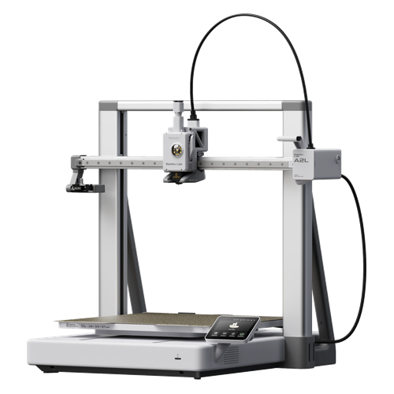
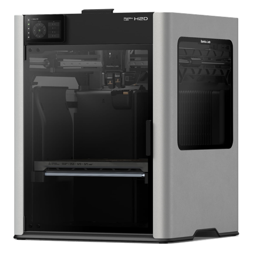
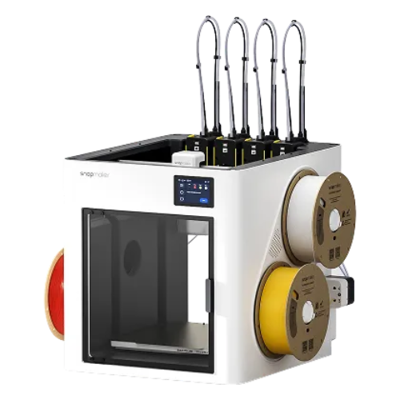
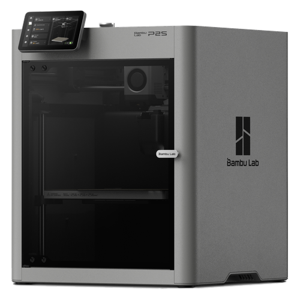
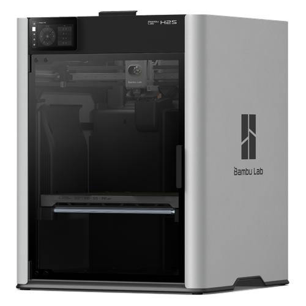
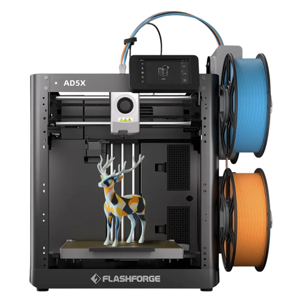

---

authors:
  - sorkin
  - makarov
icon: material/printer-3d
title: 3D рекомендатор - принтеры
subtitle: Лучшие модели под разные задачи
description: Какой принтер купить, а какой не стоит?
---

# 3D рекомендатор: Принтеры

!!! note "Рекомендуются только те принтеры, которые я лично тестировал, или близкие к ним - увеличенные/уменьшенные версии, другие комплектации и т.д. Если какого-то принтера в списке рекомендованных нет, это не всегда значит, что он плохой. Это может значить, что я его еще не успел протестировать"

!!! tip "Обсудить можно в [:simple-telegram: крупнейшем русскоязычном чате по 3D печати](https://t.me/K_3_D){ target="_blank" }"

## Базовая печать { #basic }

Это самые распространённые задачи:

1. Художественная печать - фигурки, игрушки, брелки и подобное без ограничений;
2. Базовая техническая печать - детали из простых материалов: PLA, PETG, TPU. После установки хотэнда с закалённым кончиком и подбора адгезивной пластины/клея можно небольшие детали из композитных PP и PA12 с нормальной прочностью, а также ABS, ASA, PA6 и т.д. со сниженной прочностью поперёк слоёв;
3. Базовая мультиматериальная печать - если купить вместе с AMS, то можно хорошо печатать поддержки под плоскими и горизонтальными нависающими элементами, надписи, логотипы и подобное. Поддержки под деталями сложной геометрии, а также многоцветные детали можно, причём без проблем с качеством, но долго и с большим количеством отходов.

### Bambu Lab A1

_Рекомендуемый принтер под базовые задачи_{ .printer-role }

{ width="260" }

|                  |                                                                                               |
| ----------------:|:----------------------------------------------------------------------------------------------|
| Стоимость:        | 27000-30000 ₽ |
| Область печати:   | 256×256×256 мм |
| Простота и удобство: | :material-star::material-star::material-star::material-star::material-star: |
| Скорость: | :material-star::material-star::material-star-half-full::material-star-outline::material-star-outline: |
| Надёжность: | :material-star::material-star::material-star::material-star::material-star: |
| Базовая печать: | :material-star::material-star::material-star::material-star::material-star: |
| Инженерная печать: | :material-star::material-star::material-star::material-star-outline::material-star-outline: |
| ММ печать: | :material-star::material-star::material-star::material-star-outline::material-star-outline: |
| Ликвидность: | :material-star::material-star::material-star::material-star::material-star-half-full: |

[:simple-youtube: Обзор](https://youtu.be/jPOvMQSrHZQ){ .printer-action target="_blank" } [:material-shopping: Купить](https://ali.click/p7leoy?erid=2SDnjcpg34j){ .printer-action .printer-action--primary target="_blank" }
{ .printer-actions }

Механика рябит рекордно мало и очень надёжная. Хотэнды стандартные бамбуковские, то есть быстросменные, очень распространённые, относительно не дорогие, а также есть HF версия, максимальный объёмный расход которой заметно выше среднего по рынку. Обдув хороший, есть автокалибровка PA, достаточно большая область печати. Хотэнды греются до 300°C, а стол до 100°C, из-за чего можно даже печатать базовую техничку. Есть возможность в любой момент установить мультиматериальную систему от дешёвой BMCU до AMS 2 Pro. И, что крайне важно для домашней эксплуатации, если задушить скорости, то принтер может печатать почти бесшумно.

При этом минусы не критические. Механика относительно медленная (~3000 мм/с²), но это компенсируется возможностью поставить очень производительный хотэнд. Закрытая прошивка ограничивает возможности апгрейда, но вся базовая функциональность вплоть до исключения объектов есть и работает. А то, что принтер открытый, на решение задач базовой печати не влияет.

Если учесть относительно небольшую цену, можно сказать, что у бамбу получился очень хороший принтер для домашней печати. Из-за своей простоты он хорошо подходит начинающим, да и просто тем, которые хотят меньше возиться с принтером. А опытные печатники оценят беспроблемность и тишину, из-за чего его очень удобно использовать как вспомогательный принтер дома.

??? compare "Сравнить с Flashforge AD5M"

    AD5M быстрее по механике и дешевле, а также может быть доработан до активной термокамеры. Минусом является худшая среди всех принтеров электроника, к ограничениям которой придётся привыкать, высокий уровень шума и низкая ликвидность на вторичке.
    
    A1 имеет более производительные хотэнд и обдув, область печати больше, шумит меньше вплоть до почти бесшумной работы на низких скоростях, обладает автокалибровкой ПА, можно докупить AMS и получить базовые возможности мультиматериальной печати, надёжный и беспроблемный. В дополнение к этому, это очень ликвидный принтер. Если не понравится, то его легко продать на вторичке без большой потери денег.

??? compare "Сравнить с Bambu Lab P2S"

    P2S отличается от A1 увеличенной на 10°C температурой стола, наличием пассивной термокамеры и немного более быстрой механикой. Зато достаточно сильно рябит и шумит, в отличие от вообще не рябящего и довольно тихого А1. И стоит P2S почти вдвое дороже.

    Формально, у P2S есть преимущества над A1. Но они ничтожны. Чуть-чуть увеличенная температура стола и пассивная термокамера не дают P2S нормально решать задачи технической печати. По факту, это такой же принтер под базовые задачи, как и A1, без дополнительных возможностей. Но рябящий, шумный и вдвое дороже.

    Под доработку до активной термокамеры P2S брать тоже нет смысла т.к. тогда уже выгоднее купить X2D. Это будет немного дороже, но зато и принтер более функциональный, и термокамера прикручена не кривыми костылями, и на вторичке X2D куда более ликвиден.

### Bambu Lab A1 mini

_Компактная версия A1_{ .printer-role }

{ width="260" }

|                  |                                                                                               |
| ----------------:|:----------------------------------------------------------------------------------------------|
| Стоимость:        | 16000-20000 ₽ |
| Область печати:   | 180×180×180 мм |
| Простота и удобство: | :material-star::material-star::material-star::material-star::material-star: |
| Скорость: | :material-star::material-star::material-star-outline::material-star-outline::material-star-outline: |
| Надёжность: | :material-star::material-star::material-star::material-star::material-star: |
| Базовая печать: | :material-star::material-star::material-star::material-star::material-star: |
| Инженерная печать: | :material-star::material-star-outline::material-star-outline::material-star-outline::material-star-outline: |
| ММ печать: | :material-star::material-star::material-star::material-star-outline::material-star-outline: |
| Ликвидность: | :material-star::material-star::material-star::material-star::material-star-outline: |

[:simple-youtube: Обзор](https://youtu.be/jPOvMQSrHZQ){ .printer-action target="_blank" } [:material-shopping: Купить](https://alli.pub/7a29bi?erid=2SDnjd7F7Pc){ .printer-action .printer-action--primary target="_blank" }
{ .printer-actions }

A1 mini - это уменьшенная и немного удешевлённая версия A1. Стол 180х180 кажется маленьким на фоне 256х256 у базовой модели, но на деле его для подавляющего большинства задач хватает. Другие плюсы в виде беспроблемности, хороших хотэндов и обдува, а также очень тихой работы на низких скоростях, сохранились. А цена при этом стала меньше почти вдвое.

Из обидного могу назвать только то, что максимальную температуру стола снизили со 100 до 80°C. Из-за этого печатать получится только из материалов, которые не требуют горячего стола - PLA, PETG, TPU. Инженерными материалами, которыми старший брат печатать мог, на мини версии уже без значимых танцев с бубном не попечатаешь.

??? compare "Сравнить с Flashforge AD5M"

    Стоят принтеры примерно одинаковых денег. AD5M оказывается лучше по голым характеристикам: у него больше область печати и заметно выше скорость механики, а также есть возможность зашить корпус и поставить нагреватель термокамеры, что даст возможность печатать прочные детали из ABS. Минусом является худшая среди всех принтеров электроника, к ограничениям которой придётся привыкать, высокий уровень шума и низкая ликвидность на вторичке.

    В свою очередь, А1 мини - это больше про удобство, нежели про характеристики. Он медленнее по механике, но хотэнды и обдув лучше. А1 мини не рябит, очень тихий, имеет автокалибровку ПА, надёжный и беспроблемный. А также, если он не понравится, то его можно продать достаточно быстро и без большой потери денег.

### Bambu Lab A2L

_Увеличенная версия A1_{ .printer-role }

{ width="260" }

|                  |                                                                                               |
| ----------------:|:----------------------------------------------------------------------------------------------|
| Стоимость:        | ~40000 ₽ (Голый, EU) ~56000 ₽ (Combo, EU) |
| Область печати:   | 330×320×325 мм |
| Простота и удобство: | :material-star::material-star::material-star::material-star::material-star: |
| Скорость: | :material-star::material-star::material-star-outline::material-star-outline::material-star-outline: |
| Надёжность: | :material-star::material-star::material-star::material-star::material-star: |
| Базовая печать: | :material-star::material-star::material-star::material-star::material-star: |
| Инженерная печать: | :material-star::material-star-outline::material-star-outline::material-star-outline::material-star-outline: |
| ММ печать: | :material-star::material-star::material-star::material-star-outline::material-star-outline: |
| Ликвидность: | :material-star::material-star::material-star::material-star::material-star-outline: |

[:simple-youtube: Обзор](){ .printer-action target="_blank" } [:material-shopping: Купить](){ .printer-action .printer-action--primary target="_blank" }
{ .printer-actions }

На первый взгляд, это просто увеличенная версия A1 за немного большие деньги. Но есть значимое отличие - у A2L температура стола ограничена 80°C, из-за чего печатать базовую техничку из инженерных материалов уже не получится без танцев с бубном. Поэтому рассматривать эту версию стоит только если у вас реально есть задачи под крупногабаритную печать из базовых материалов - PLA, PETG, TPU. Если же хотите чуть более универсальный принтер, то стоит брать обычный A1.

## Инженерная печать { #engineering }

Принтеры под инженерную печать отличаются от принтеров под базовые задачи тем, что они способны печатать более широкой номенклатурой материалов, а также имеют некоторые особенности, позволяющие печатать детали более прочными. Если точнее, то принтеру под инженерку:

- Критически важны высокие максимальные температуры хотэнда и стола;
- Критически важно наличие активной термокамеры хотя бы до 65°С;
- Желательно наличие производительного хотэнда хотя бы в виде опции т.к. это увеличивает прочность деталей;
- Желательно наличие двойного экструдера для печати легкоотделяемых поддержек, которые не портят геометрию деталей, а также позволяют экономить дорогие инженерные материалы.

### Bambu Lab X2D

_Рекомендуемая модель под инженерную печать_{ .printer-role }

{ width="260" }

|                  |                                                                                               |
| ----------------:|:----------------------------------------------------------------------------------------------|
| Стоимость:        | ~70000 ₽ (Голый, CN) ~90000 ₽ (Combo, CN) |
| Область печати:   | 256×256×260 мм |
| Простота и удобство: | :material-star::material-star::material-star::material-star::material-star-half-full: |
| Скорость: | :material-star::material-star::material-star::material-star::material-star-outline: |
| Надёжность: | :material-star::material-star::material-star::material-star::material-star: |
| Базовая печать: | :material-star::material-star::material-star::material-star::material-star: |
| Инженерная печать: | :material-star::material-star::material-star::material-star::material-star: |
| ММ печать: | :material-star::material-star::material-star::material-star-half-full::material-star-outline: |
| Ликвидность: | :material-star::material-star::material-star::material-star::material-star: |

[:simple-youtube: Обзор](https://youtu.be/xmrUdBrgTOY?si=fvq1VXGmuF6XyfWv){ .printer-action target="_blank" } [:material-shopping: Купить](https://market.yandex.ru/cc/BQMxDs?erid=5jtCeReNx12oak2syJLWLrQ){ .printer-action .printer-action--primary target="_blank" }
{ .printer-actions }

Bambu Lab X2D - один из самых сбалансированных принтеров, ориентированных на инженерную печать. Механика у него относительно медленная, зато относительно мало рябит, и, самое главное, она очень надёжная и беспроблемная. На практике принтеры с этой механикой могут отходить много тысяч часов без значимых поломок.

На голове "полуторный" экструдер, который отлично справляется с самыми распространёнными задачами инженерной печати - легкоотделяемыми поддержками, надписями и логотипами. Хотэнды греются до 310°С, стол до 120°С, плюс есть термокамера на 65°С, благодаря чему можно печатать прочные детали из любых инженерных материалов, кроме PPS. При этом хотэнды и обдув имеют очень высокую производительность, а также принтер напичкан удобствами: фильтрацией воздуха, вентиляцией отсека печати, автокалибровкой PA на основном экструдере, удобной AMS 2 Pro и т.д.

Из минусов можно отметить разве что закрытый софт и относительно высокую цену. Но, справедливости ради, современный бамбуковский софт душит уже не так сильно, как раньше. А по цене - принтеров с такими же возможностями и надёжностью дешевле нет.

Суммарно получается принтер, который отлично справляется с техничкой, но при этом и с художкой проблем никаких, и многоцвет иногда можно, и мозги особо не делает в ходе эксплуатации. Отличный выбор для тех, кому хватает бюджета на его покупку.

??? compare "Сравнить с QIDI Q2"

    Q2 стоит почти вдвое дешевле, имеет область печати чуть больше, ускорения повыше, а также хотэнды греются лучше, за счёт чего становится доступен PPS. Но при этом у него менее производительные хотэнды, сильно менее производительный обдув, нет двойного экструдера и уровень качества и надёжности заметно хуже. Поэтому, если есть деньги на X2D, то я бы брал его. Если же бюджет не позволяет взять X2D, а техничку печатать надо, тогда Q2 будет оптимальным выбором

??? compare "Сравнить с Snapmaker U1"

    Принтеры крайне разные. X2D имеет активную термокамеру. Хотэнды и обдув заметно более производительные. А мультиматериальная система, хоть и способна распечатать трёх-четырёхцветную деталь, но больше заточена под печать легкоотделяемых поддержек, надписей, логотипов и тому подобного, что часто встречается в техничке.
    
    Snapmaker U1 имеет заметно менее производительные хотэнды и обдув, не имеет даже пассивной термокамеры, не имеет сушилки и системы хранения филамента. Зато имеет 4 полноценные печатающие головы, которые будут экономить много времени при печати трёх-четырёхцветных деталей. А также имеет неплохую электронику с открытой прошивкой, за счёт чего хорошо поддаётся доработкам.
    
    Итого получается, что если у вас большая часть задач - инженерная печать, а мультиматериал нужен редко, то берите X2D. Если у вас сплошные многоцветные детали, а продвинутой инженерной печати не бывает, тогда U1

??? compare "Сравнить с Bambu Lab P2S"

    P2S отличается от X2D заметно более высоким уровнем ряби, наличием только 1 экструдера, а также отсутствием нагревателя термокамеры. При этом цена ниже на ~20000р. На первый взгляд может показаться, что адеквватный вариант - по возможностям урезали, но и денег просят меньше. Но есть одно большое но: возможностей отрезали столько, что P2S стал функциональным аналогом A1. Он буквально не может решать какие-то задачи, которые A1 решать не мог бы, или решал бы плохо. При этом A1 дешевле на ~20000р., меньше рябит и заметно более тихий. Поэтому P2S покупать смысла нет. Либо берите A1, либо X2D

??? compare "Сравнить с Bambu Lab H2D"

    H2D имеет область печати заметно больше, хотэнды такие же, но греть их можно уже до 350°С, а также оба экструдера полноценные. Несмотря на то, что по цифрам всё хорошо, но на практике увеличенная максимальная температура хотэнда даёт только возможность печати PPS, который очень мало кому нужен. А то, что второй экструдер полноценный, в рамках технической печати вообще почти ничего не меняет. Поэтому я бы рассматривал H2D как просто заметно увеличенную версию X2D (или, наоборот, X2D как заметно уменьшенную версию H2D)

### QIDI Q2

_Более дешёвая альтернатива под техничку_{ .printer-role }

{ width="260" }

|                  |                                                                                               |
| ----------------:|:----------------------------------------------------------------------------------------------|
| Стоимость:        | ~40000-45000 ₽ (Без Box)                                                                                |
| Область печати:   | 270×270×256 мм |
| Простота и удобство: | :material-star::material-star::material-star-outline::material-star-outline::material-star-outline: |
| Скорость: | :material-star::material-star::material-star::material-star::material-star-outline: |
| Надёжность: | :material-star::material-star::material-star::material-star-outline::material-star-outline: |
| Базовая печать: | :material-star::material-star::material-star::material-star-outline::material-star-outline: |
| Инженерная печать: | :material-star::material-star::material-star::material-star::material-star: |
| ММ печать: | :material-star::material-star::material-star-outline::material-star-outline::material-star-outline: |
| Ликвидность: | :material-star::material-star::material-star-outline::material-star-outline::material-star-outline: |

[:simple-youtube: Обзор](https://youtu.be/V9vqKQp8-GM){ .printer-action target="_blank" } [:material-file-document: Доработки](../printers/qidi_q2/index.md){ .printer-action target="_blank" } [:material-shopping: Купить](https://alli.pub/7a29ef?erid=2SDnjcyqWTp){ .printer-action .printer-action--primary target="_blank" }
{ .printer-actions }

QIDI Q2 в первую очередь заточен под решение задач инженерной печати. Хотэнд греется до 350°C и имеет неплохую производительность. Стол относительно большой и греется до 125°C, чего хватает на все филаменты. Есть активная термокамера до 65°C, позволяющая печатать прочные детали из ABS-подобных филаментов. Низкий уровень ряби, довольно высокие ускорения и возможность очень хорошо печатать самыми мягкими эластомерами. И очень низкую цену как для такого набора характеристик и возможностей.

Минусом является плохое охлаждение, из-за чего в художественной печати придётся значимо душить скорости или апгрейдить систему охлаждения. Проблемы с софтом в стоке, что решается по уже существующей [готовой инструкции](../printers/qidi_q2/index.md){ .target="_blank" }. Также надо отметить, что довольно много жалоб на доставку - принтеры часто приходят битыми. В таком случае их меняют без проблем, но время потратить придётся. А также Q2 довольно рандомный по качеству. У большинства всё нормально. Но процент брака всё равно выше среднего.

Суммарно, получается принтер, характеристики и возможности которого значимо лучше, чем ожидается за такую цену, но зато качество изготовления невысокое. В умелых руках принтер даст пользователю очень много за мало денег. В неумелые его лучше не покупать.

Отдельно стоит отметить Qidi Box - систему автоматической смены материала, которая идёт в комбо версии принтера. Она показывает себя очень проблемной, при этом софт у неё закрыт => по-нормальному исправить ничего не получится. Поэтому рекомендуется рассматривать принтер в варианте без Box.

??? compare "Сравнить с Bambu Lab X2D"

    X2D стоит почти вдвое дороже, имеет область печати чуть-чуть меньше, ускорения немного ниже, а также хотэнды у него греются не до 350, а до 310°C. Но при этом у него более производительные хотэнды, сильно более производительный обдув, двойной экструдер и X2D заметно более простой и надёжный в эксплуатации. Поэтому, если есть деньги на X2D, то я бы брал его. Q2 же имеет смысл только если бюджета на X2D не хватает, но печатать техничку надо.

### Bambu Lab H2D

{ width="260" }

|                  |                                                                                               |
| ----------------:|:----------------------------------------------------------------------------------------------|
| Стоимость:        | ~160000 ₽ (Combo, CN) ~200000 ₽ (Combo, EU) |
| Область печати:   | 350×320×320 мм |
| Простота и удобство: | :material-star::material-star::material-star::material-star::material-star-half-full: |
| Скорость: | :material-star::material-star::material-star::material-star::material-star-outline: |
| Надёжность: | :material-star::material-star::material-star::material-star::material-star: |
| Базовая печать: | :material-star::material-star::material-star::material-star::material-star: |
| Инженерная печать: | :material-star::material-star::material-star::material-star::material-star: |
| ММ печать: | :material-star::material-star::material-star::material-star::material-star-outline: |
| Ликвидность: | :material-star::material-star::material-star::material-star::material-star: |

[:simple-youtube: Обзор](){ .printer-action target="_blank" } [:material-shopping: Купить](){ .printer-action .printer-action--primary target="_blank" }
{ .printer-actions }

H2D - это крупногабаритный принтер Bambu Lab, заточенный под инженерную печать. Стол большой и греется до 120°C. Полноценный двойной экструдер, который позволяет эффективно печатать не только легкоотделяемые и растворяемые поддержки и надписи, но и полноценно двухматериальные детали. Хотэнды как у других современных бамбуков, то есть распространённые, довольно дешёвые, и есть версия с очень высоким максимальным объёмным расходом. При этом на H2D их максимальная температура ограничена уже 350°C, чего хватает буквально для всех распространённых филаментов. Активная термокамера до 65°C, а, если даунгрейднуть прошивку, то и до 70°C. Механика рябит очень мало и выдаёт средние как для принтеров такого размера ускорения (~5000 мм/с²).

Суммарно, из серийных принтеров это топовое решение под печать технички, с возможностью неплохо попечатать и художку, и даже несложные мультиматериальные детали. Платить за это придётся большим габаритом и массой, высоким уровнем шума (как у X2D), а также очень высокой ценой принтера даже в китайской версии.

Отдельно стоит отметить, что у этого принтера есть возможность установить 2 вида лазера и резак. Это можно получить в некоторых комплектациях, которые в РФ не особо распространены, а также докупив и установив вручную один из наборов по доработке. Но лично я это не тестировал, поэтому сказать, имеет ли оно хоть какой-то смысл не могу.

??? compare "Сравнить с Bambu Lab X2D"

    X2D - уменьшенная и удешевлённая версия X2D. Из значимых отличий у X2D меньше область печати и температура хотэндов ограничена до 310°C, из-за чего тот не может печатать PPS. А также у X2D второй экструдер неполноценный, а боуден. При печати поддержек, логотипов и надписей, а также внутренних элементов, это будет заметно только в том, что печать этим вторым экструдером чуть медленнее. Но внешние элементы им качественно уже не попечатаешь. В то время как на H2D попечатаешь.

    Суммарно, отличия по возможностям небольшие, и большинство людей их в реальной эксплуатации не заметят. Поэтому я бы расценивал X2D как просто уменьшенную версию H2D за меньше денег.

??? compare "Сравнить с Bambu Lab H2C"

    H2C - это H2D, у которого вместо правого экструдера тулченджер. При этом тулченджер этот весьма посредственный, ведь, хоть и имеет довольно много каналов, но меняет филамент очень долго - около 40 секунд. Это примерно вдвое быстрее, чем менять филамент через AMS, и примерно втрое медленнее, чем его меняют полноценные тулченджеры. Учитывая то, что H2C при этом стоит примерно на 40000-60000 ₽ дороже, а также тот факт, что уже анонсированы полноценные тулченджеры от Bambu Lab, я бы его на данный момент всерьёз не рассматривал.

## Мультиматериальная печать { #multimaterial }

Если у вас возникает необходимость напечатать многоцветную деталь раз в месяц, а то и реже, то вам для этого хватит какого-нибудь принтера под базовые задачи с AMS. Но, если вам надо печатать многоцветные детали очень часто, то медлительность AMS даст о себе знать. Тогда адекватно будет перейти на принтеры с тулченджером, то есть системой автоматической смены инструмента (обычно, хотэнд или печатающая голова целиком). Они меняют материал значительно быстрее (обычно ~15с против ~90с), за счёт чего при частой мультиматериальной печати сэкономят очень много времени. Расплачиваться за это придётся заметно большей стоимостью как самого принтера, так и его эксплуатации.

### Snapmaker U1

_4-экструдерный тулченджер_{ .printer-role }

{ width="260" }

|                  |                                                                                               |
| ----------------:|:----------------------------------------------------------------------------------------------|
| Стоимость:        | ~75000 ₽ |
| Область печати:   | 270×270×270 мм |
| Простота и удобство: | :material-star::material-star::material-star::material-star-half-full::material-star-outline: |
| Скорость: | :material-star::material-star::material-star::material-star::material-star-outline: |
| Надёжность: | :material-star::material-star::material-star::material-star::material-star-outline: |
| Базовая печать: | :material-star::material-star::material-star::material-star::material-star: |
| Инженерная печать: | :material-star::material-star::material-star::material-star-outline::material-star-outline: |
| ММ печать: | :material-star::material-star::material-star::material-star::material-star: |
| Ликвидность: | :material-star::material-star::material-star::material-star::material-star: |

U1 - принтер противоречивый. Механика достаточно быстрая, рябит средне и показала себя довольно надёжной, если не забывать обслуживать её. Подающие механизмы всем, включая ТПУ, печатают хорошо. Хотэнд посредственный, производительностью чуть ниже среднего, но хотя бы от перегревов не страдает. Обдув средненький. Работает принтер громко, на уровне X2D/Q2, то есть спать рядом будет невозможно. Электроника отличная, плюс софт открытый и очень функциональный, а также есть автоматическая калибровка PA.

При этом продуман U1 на уровне раннего прототипа. Использованы карбоновые валы, боящиеся пыли, но крышки сверху нет. Красивая и удобная при этом стоит очень дорого, так что придётся надевать на принтер пластиковое корыто из икеи. Стоят податчики филамента, которые должны упрощать смену филамента. Но они реализованы так ужасно, что делают смену филамента дольше и менее удобной, чем если бы их не было. Электроника отличная, но висит в отсеке печати, да без охлаждения. И так далее.

В общем, без учёта мультиматериальной системы, U1 - это рабочий, но очень непродуманный и сырой принтер, который внимания не стоил бы. Но мультиматериальная система у него есть. Тут стоит полноценный тулченджер на 4 головы, причём очень стабильно работающий. И это ситуацию меняет, ведь конкурентов с таким же тулченджером, да стабильной механикой, да хорошей электроникой и софтом, у принтера нет.

Отдельно хочу отметить, что, скорее всего, этот принтер достаточно быстро устареет. На данный момент он имеет смысл только по принципу "на безрыбье и рак рыба". Плюс к этому, 4 головы для полноцветной печати мало, там надо как минимум 5 (CMYKW), а лучше 7 (CMYKW + серый/телесный + поддержки). Скорее всего, в ближайший год выйдут не такие сырые принтеры, да с большим количеством инструментов, что сделает Snapmaker U1 устаревшим. Поэтому, если задачи терпят, то мб стоит подождать.

??? compare "Сравнить с Bambu Lab X2D"

    Принтеры крайне разные. X2D имеет активную термокамеру. Хотэнды и обдув заметно более производительные. А мультиматериальная система, хоть и способна распечатать трёх-четырёхцветную деталь, но больше заточена под печать легкоотделяемых поддержек, надписей, логотипов и тому подобного, что часто встречается в техничке.
    
    Snapmaker U1 имеет заметно менее производительные хотэнды и обдув, не имеет даже пассивной термокамеры, не имеет сушилки и системы хранения филамента. Зато имеет 4 полноценные печатающие головы, которые будут экономить много времени при печати трёх-четырёхцветных деталей. А также имеет неплохую электронику с открытой прошивкой, за счёт чего хорошо поддаётся доработкам.
    
    Итого получается, что если у вас большая часть задач - инженерная печать, а мультиматериал нужен редко, то берите X2D. Если у вас сплошные многоцветные детали, а продвинутой инженерной печати не бывает, тогда U1

## Под доработку

### FlashForge AD5M

_Дешёвый принтер под доработку_{ .printer-role }

{ width="260" }

|                  |                                                                                               |
| ----------------:|:----------------------------------------------------------------------------------------------|
| Стоимость:        | ~17000 ₽ |
| Область печати:   | 220×220×250 мм |
| Простота и удобство: | :material-star::material-star::material-star-outline::material-star-outline::material-star-outline: |
| Скорость: | :material-star::material-star::material-star::material-star::material-star-outline: |
| Надёжность: | :material-star::material-star::material-star::material-star::material-star: |
| Базовая печать: | :material-star::material-star::material-star::material-star::material-star: |
| Инженерная печать: | :material-star::material-star::material-star-half-full::material-star-outline::material-star-outline: |
| ММ печать: | :material-star-outline::material-star-outline::material-star-outline::material-star-outline::material-star-outline: |
| Ликвидность: | :material-star::material-star::material-star-outline::material-star-outline::material-star-outline: |

[:simple-youtube: Обзор](https://youtu.be/Cgj59XTgrjE){ .printer-action target="_blank" } [:material-shopping: Купить](https://ali.click/7y4fo7?erid=2SDnjeHL4eb){ .printer-action .printer-action--primary target="_blank" }
{ .printer-actions }

Adventurer 5M - компактный, относительно быстрый (~7500 мм/с²) и рябит не сильно. Электроника очень чахлая, может вылететь в ошибку от неправильного выставления параметров или совершения некоторых действий с принтером пока тот печатает.

Хотэнд, с одной стороны, производительнее среднего. С другой стороны, из-за неудачного крепления не может греться выше 280°C. Следовательно, в стоке принтер не способен решать никакие задачи, кроме базовой печати. Но в них он на голову хуже Bambu Lab A-серии т. к. скорость печати не настолько больше, чтобы компенсировать куда худшее качество, шумность, нестабильность, отсутствие автокалибровки ПА и т.д.

Иными словами, этот принтер имеет смысл только тогда, когда нужна продвинутая техническая печать, или печать мягкими эластомерами, но денег на принтер, который это всё хорошо смог бы в стоке, нет. Купить Adventurer 5M за ~18000р, а потом по чуть-чуть доработать его еще на ~10000р финансово проще, чем единоразово вложить в готовый принтер 35000-50000р.

### Sovol SV08

_Дешёвый крупногабаритный принтер_{ .printer-role }

{ width="260" }

|                  |                                                                                               |
| ----------------:|:----------------------------------------------------------------------------------------------|
| Стоимость:        | ~38000 ₽ (250$) |
| Область печати:   | 350×350×345 мм |
| Простота и удобство: | :material-star::material-star-half-full::material-star-outline::material-star-outline::material-star-outline: |
| Скорость: | :material-star::material-star::material-star::material-star::material-star-outline: |
| Надёжность: | :material-star::material-star::material-star::material-star::material-star-outline: |
| Базовая печать: | :material-star::material-star::material-star::material-star::material-star: |
| Инженерная печать: | :material-star::material-star::material-star::material-star-outline::material-star-outline: |
| ММ печать: | :material-star-outline::material-star-outline::material-star-outline::material-star-outline::material-star-outline: |
| Ликвидность: | :material-star::material-star-outline::material-star-outline::material-star-outline::material-star-outline: |

[:material-file-document: Обзор на сайте](../articles/sv08/sv08.md){ .printer-action target="_blank" } [:material-shopping: Купить](https://ali.click/mu9foz?erid=2SDnje5VWKZ){ .printer-action .printer-action--primary target="_blank" }
{ .printer-actions }

Sovol SV08 довольно быстрый для своей области печати (~7000 мм/с²). Диапазоны скоростей без ряби не очень большие, но есть. Хотэнд по производительности средний, но обдув заметно производительнее среднего. Электроника, хоть и дешёвая, но и без каких-то дурацких решений. Прошивка - почти чистый Klipper, легко меняется на полностью стоковый Klipper. А также производителем выложены сборки механики, что сильно упрощает апгрейды принтера.

В противовес этому обдув очень шумный. Хотэнда для такой области печати как будто бы маловато. Датчик автоуровня страдает от температурного дрейфа. А также есть проблема с неправильным креплением стола, из-за чего тот сильно выгибается при нагреве. Решается она [переделкой крепления на пружины или силиконовые прокладки](https://youtu.be/xGcPHl1sPP0?si=yl4EX0q_MFG_qae8){ target="_blank" }.

В общем, хотите, чтобы что-то подобного габарита не надо было дорабатывать, увеличивайте бюджет раз в 5. Sovol SV08 - это дешёвый крупногабаритный принтер, который в стоке не идеален, но печатает. Но хорошо апгрейдится, благодаря чему можно его легко доделать до выполнения продвинутых задач, скоростной печати и т.д.

Также надо отметить, что у SV08 есть увеличенная версия - [SV08 Max](https://ali.click/9jefoq?erid=2SDnjeh6tVV){ target="_blank" }. Она имеет стол 500×500 мм, но ускорения ниже (~4000 мм/с²) и цена сильно выше.

## Нерекомендуемые принтеры

В данном разделе содержится информация о том, почему некоторые протестированные мной принтеры не попали в список рекомендуемых, или выбыли из него. Обратите внимание, что факт нахождения в этом списке не значит, что принтер ужасен, печатать не может и т.д. Просто персонально я считаю, что именно покупать принтеры из этого списка на данный момент смысла не имеет по тем или иным причинам. Если какой-то из этих принтеров у вас есть, и он вас устраивает, то менять его не надо.

- { width="120" }

    **Refurbished принтеры Bambu Lab**

    ---

    Refurbished - бывшие в употреблении принтеры, которые восстановили и вернули в продажу. Они почти всегда имеют явные следы эксплуатации, а также неизвестно сколько они прослужат. Учитывая то, что цена на них не сильно ниже, чем на новые, брать рефабы я бы не стал.

- { width="120" }

    **Bambu Lab P1S / P1P / X1C**

    ---

    Первое поколение бамбуков не выдерживает конкуренции с более дешёвым А1. У них такие же ограничения температур и тоже отсутствует активная термокамера, из-за чего они не могут решать какие-то задачи, которые не может решать А1. При этом они очень сильно рябят и шумные, когда А1 не рябит и тихий. У них нет автокалибровки PA (кроме X1C), а у А1 есть. У них хотэнды и обдув слабее. А цена выше. Поэтому покупать старые поколения, по моему мнению, нет смысла даже под доработку. Эти принтеры банально устарели.

- { width="120" }

    **Bambu Lab P2S**

    ---

    P2S стоит ближе к X2D, а по возможностям не особо отличается от A1. В итоге это странная модель, которая уже не дешёвая, но за эту переплату по сравнению с A1 ничего, кроме защиты от пыли, не даёт. По моему мнению, если нужно печатать техничку, то стоит добавить и взять X2D т.к. он заметно лучше при не сильно более высокой цене. А, если техничка не нужна, то стоит спуститься до A1 и получить более тихий и менее рябящий принтер за сильно меньше денег.

- { width="120" }

    **Bambu Lab H2S**

    ---

    Фактически, это H2D, но с одинарным экструдером. При этом цена в условиях РФ почти такая же, как на H2D. В таком случае, зачем отказываться от очень важной для инженерной печати фишки, если при этом не получится даже денег сэкономить?

- { width="120" }

    **Flashforge AD5X**

    ---

    Фактически, это AD5M, только с более проблемным хотэндом, и простенькой мультиматериальной системой. Брать под эксплуатацию без доработок смысла нет т.к. за те же деньги A1 mini + BMCU выглядит вариантом заметно лучше: тише и сильно менее проблемный. Под доработку под АТК тоже большого смысла нет т.к. суммарная стоимость сборки получается уже такой, что проще взять готовый Q1 Pro или б/у Q2, которые будут на голову лучше.

- { width="120" }

    **[Серия Neptune 4](https://alli.pub/7afabp?erid=2SDnjcCDEyM){ target="_blank" }**

    ---

    Нет акселерометров и Wi-Fi, которые придётся докупать, устанавливать и настраивать самостоятельно. Бывает, что механику нельзя настроить без слесарной доработки деталей. Характеристики по современным меркам уже слабоваты

- { width="120" }

    **Принтеры на прошивке Marlin**

    ---

    Хоть принтеры на этой прошивке до сих пор могут печатать с хорошим качеством, но отсутствие нормальной реализации Input Shaping'а делает их медленными. Плюс к этому, новых принтеров на этой прошивке не делают, следовательно, всё, что есть в продаже - принтеры, вышедшие несколько лет назад. Естественно, за столько времени большинство из них уже устарело.

---

^`Реклама: ООО "АЛИБАБА.КОМ (РУ)" ИНН 7703380158`^[^1]
^`Реклама. ООО "АЕР Услуги" ИНН 7703380158.`^[^1]
^`Реклама. ООО «Яндекс Маркет», ИНН 9704254424`^[^1]

[^1]: Нет человека или юр.лица, которые заказали бы создание этой страницы или рекламу товаров, приводимых на этой странице. Я создал все статьи в рекомендаторе сам, по своему желанию и в целях сообщества. Тем не менее, по законодательству РФ, любая ссылка на товар является рекламой. Поэтому я вынужден делать эту приписку, чтобы не нарушать закон

*[LA]: Linear Advance - алгоритм, синхронизирующий экструзию филамента с перемещениями печатающей головы. Убирает множество дефектов печати. В некоторых прошивках может называться по-другому, например, Pressure Advance (PA) или Pressure Control.
*[МОР]: Максимальный Объёмный Расход хотэнда, то есть какой объём материала хотэнд способен эффективно прогреть за единицу времени. Считается как [скорость перемещения печатающей головки] x [высота слоя] x [ширина линии]
*[ММ]: Мультиматериальный
*[ММ печать]: Мультиматериальная печать
